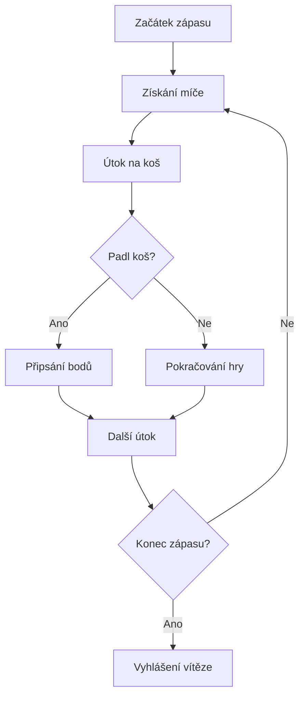

#  NBA 2K27 –  Basketbalu

> Vítej ve světě NBA 2K27! Tento projekt představuje basketbalovou herní sérii NBA 2K, její herní režimy, zajímavé funkce a možnosti, které nabízí hráčům.

---

##  1. Co je NBA 2K27?

NBA 2K je známá série basketbalových sportovních her, ve které si můžeš zahrát za profesionální basketbalové týmy a vytvořit si vlastního hráče.

Hlavním cílem hry je nabídnout co nejrealističtější basketbalový zážitek.

**Mezi hlavní vlastnosti patří:**
- Realistická basketbalová grafika.
- Velký výběr týmů a hráčů.
- Různé herní režimy.
- Možnost hrát online proti ostatním.
- Vytváření vlastního basketbalisty.

*Basketbal není jen o bodech, ale také o taktice, rychlosti a týmové spolupráci.*

##  2. Herní režimy

### MyCAREER

V tomto režimu si vytvoříš vlastního basketbalistu a postupně buduješ jeho kariéru. Zlepšuješ jeho schopnosti a snažíš se dostat mezi nejlepší hráče NBA.

### MyTEAM

V režimu MyTEAM si sestavuješ vlastní tým z různých basketbalových hráčů. Snažíš se vytvořit co nejsilnější sestavu a porážet soupeře.

### MyNBA

V MyNBA se stáváš manažerem basketbalového klubu. Můžeš rozhodovat o přestupech, sestavě a budoucnosti svého týmu.

##  3. Výhody a nevýhody NBA 2K

| Výhody | Nevýhody |
|---|---|
| Realistická grafika | Některé funkce mohou být placené |
| Velký výběr herních režimů | Náročnější ovládání |
| Online multiplayer | Závislost na internetu |
| Vlastní basketbalista | Některé režimy mohou být opakující se |
| Známé basketbalové týmy | Pravidelné vydávání nových verzí |

## 🔗 4. Zajímavé odkazy

Pokud tě NBA 2K zajímá, můžeš navštívit následující stránky:

- [Oficiální stránky NBA 2K](https://nba.2k.com/)
- [Oficiální stránky NBA](https://www.nba.com/)

Najdeš zde informace o basketbalu, hráčích, novinkách a samotné herní sérii.

##  5. Můj seznam úkolů

Co bych chtěl ve hře vyzkoušet:

- [ ] Vytvořit vlastního basketbalistu.
- [ ] Vyzkoušet různé herní režimy.
- [ ] Zjistit, jak funguje MyTEAM.
- [x] Vyhrát důležitý turnaj.
- [ ] Vytvořit co nejsilnější tým.
- [x] Zlepšit své basketbalové dovednosti.
      

##  6. Jak funguje basketbalový zápas?

Basketbalový zápas se skládá ze čtyř čtvrtin. Dva týmy se snaží získat více bodů než soupeř.

Základní bodování:

- **1 bod** – úspěšný trestný hod.
- **2 body** – běžný koš z prostoru uvnitř trojkového oblouku.
- **3 body** – koš z prostoru za trojkovým obloukem.

### Průběh zápasu

## 🏀 7. Moje hodnocení

Podle mě je NBA 2K zajímavá herní série především pro fanoušky basketbalu. Nejvíce mě baví možnost vytvořit si vlastního hráče, hrát za oblíbené týmy a soutěžit s ostatními hráči.

**Celkově bych NBA 2K doporučil každému, kdo má rád basketbal a sportovní hry.**

---

